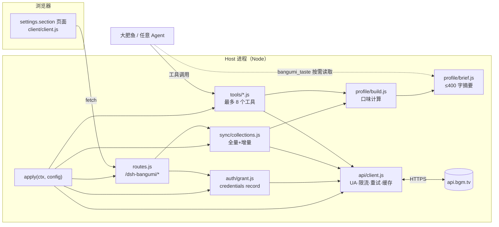

# dsh-bangumi-account · 需求分析与功能设计

> 版本：v0.2（设计定稿，未实现）
> 日期：2026-11-07
> 目标读者：本插件实现者（我 / 后续贡献者）、以及要把它接进「大肥鱼」生活系统的人
>
> **v0.2 变更**（基于主人决策）：写权限纳入 v1 但做成设置开关、默认关闭；登录确定令牌优先、OAuth 折叠；**口味摘要注入本版不做**，改为纯工具按需查询，注入方案另议；不向其他插件暴露服务接口。

---

## 0. 一页结论

**做什么**：一个 DSH 原生插件。在 `设置 → Bangumi` 里登录 Bangumi 账号，把主人的收藏、评分、在看进度同步到本地，算出一份「口味档案」；再通过一组意图型工具把「查动画」和「懂主人」两种能力交给大肥鱼。

**三个关键判断**：

1. **做原生插件，不做 MCP 服务。** MCP 方案能查数据，但做不了两件这件事最关键的事：在设置页里登录、把 token 存进凭据库。MCP 还额外要求用户装 Python + uv 起进程。原生插件 0 依赖、无外进程。（第 1.5 节给了对比表；MCP 作为可选的第三条出口保留。）
2. **登录以「个人访问令牌」为主路径，OAuth 为高级路径。** Bangumi 的 OAuth 需要先在后台登记应用并固定回调地址（人工审核），对「给自家鱼用」这个场景太重；令牌粘贴 + `/v0/me` 验证 10 秒完成。
3. **给鱼的不是「一堆收藏数据」，而是「一份会说话的口味档案 + 一个能追问的工具」。** 原始收藏列表塞进上下文又贵又没用。本版**不往上下文里注入任何东西**：鱼想知道主人的口味，就调 `bangumi_taste`；想知道细节，就调 `bangumi_my_list`。（摘要注入方案留到之后再讨论，见 3.6。）
4. **写权限是主人的开关，不是插件的默认能力。** 设置页里一个「允许大肥鱼修改我的收藏」的开关，默认关；关着的时候写工具**根本不注册**，模型连看都看不到。

**范围边界**：不做番组计划全量爬虫，不做字幕/资源站，不做社交（评论别人、发布目录），不做自动追番。

---

## 1. 调研

### 1.1 为什么大肥鱼需要这个插件

「大肥鱼」是 DSH 上流行起来的 AI 角色生活系统（代表实现 [`minedalang/dsh-dafeiyu-life`](https://github.com/minedalang/dsh-dafeiyu-life)、[`gosomea/dsh-bigfish`](https://github.com/gosomea/dsh-bigfish)、[`Morgiana-V3/dsh-feed-the-seek`](https://github.com/Morgiana-V3/dsh-feed-the-seek)）。这类系统共同的设计取向是：

- **有独立的生活域**：会自己刷 B 站、认识人、积累经历（见 dafeiyu-life 的 README：自主探索、模拟心情、会遗忘的记忆）。
- **有管理中心**：`设置 → 大肥鱼 → 管理中心`，登录第三方平台、逐项授权（同上）。
- **拒绝只做任务执行器**：她的「喜好」要从真实经历里长出来，而不是被写死。

Bangumi（番组计划）在这套设定里补的正是**「主人的二次元履历」**这一块：主人给什么打过 9 分、什么看了三集就弃、最近在追什么、写过什么长评。这是全网最结构化的一份「他喜欢什么」的证据。B 站数据回答「他在看什么视频」，Bangumi 数据回答「他认可什么作品」——两者不重叠。

由此推出插件的**双重定位**：

| 定位 | 对鱼的价值 | 对主人的价值 |
|---|---|---|
| 数据源（查动画） | 能回答「这部番讲什么、几集、谁做的、评分多少、这周几更新」 | 少开一个网页 |
| 品味镜像（懂主人） | 能说「你不喜欢慢热，但这部你可能会破例」 | 被理解的感觉；也方便鱼做推荐 |

调研中值得注意的一点：dafeiyu-life 明确写了「**发现视频资料不等于真的听过音轨**」「**不能把任务当生活**」。这提示我们——插件只应提供**事实与偏好证据**，不能替鱼编造「我看过」。工具返回里要能区分「主人的收藏」和「作品的公共信息」，且鱼引用时能说清来源。

### 1.2 Bangumi 开放平台现状

一手资料：[`bangumi/api`](https://github.com/bangumi/api)（OpenAPI v0 规范、鉴权文档、UA 规范）与在线文档 <https://bangumi.github.io/api/>。

**API 根地址**：`https://api.bgm.tv`（v0 REST）。条目/章节/角色/人物/用户/收藏/目录/搜索/日历共 47 条路径、56 个操作。

**鉴权**（文档 [`How-to-Auth.md`](https://github.com/bangumi/api/blob/master/docs-raw/How-to-Auth.md)）：

- OAuth 2.0 authorization code。授权页 `https://bgm.tv/oauth/authorize`，换 token `POST https://bgm.tv/oauth/access_token`，刷新用 `grant_type=refresh_token`，查状态 `POST https://bgm.tv/oauth/token_status`。
- Access Token 有效期 `expires_in: 604800`（7 天），同时下发 `refresh_token` 与 `user_id`。
- **官方文档写明 `scope` 尚未实现**（"请求权限 尚未实现"），但规范里写接口标了 `write:collection` / `write:indices`。结论：**写权限无法在授权时细分，只能由插件侧用配置开关自己管**。
- Header 传 `Authorization: Bearer <token>`；v0 不再接受 query string 传 token。
- 报错语义：`401` 未授权、`403` 缺 scope、`404`（用于「未收藏/私有收藏」这种语义）。

**个人访问令牌**：社区通行做法是在 <https://next.bgm.tv/demo/access-token> 生成（见 [`etherwindy/Bangumi-MCP`](https://github.com/etherwindy/Bangumi-MCP) README）。公开读接口不需要 token；`/v0/me` 与所有写接口需要。

**User-Agent 要求**（[`user agent.md`](https://github.com/bangumi/api/blob/master/docs-raw/user%20agent.md)）：非浏览器客户端必须带**开发者 ID + 应用名**，开源项目还要带主页；`database`、`Bangumi/1.0` 这类 UA 会被封。**这一条是硬性要求，插件必须可配置 UA。**

**已知坑**（来自规范与 MCP 项目的实测记录）：

- 部分接口标注但服务端未实现，例如 `DELETE /v0/characters/{id}/collect`（[bangumi/api#234](https://github.com/bangumi/api/issues/234)）。
- 目录（index）没有删除接口，只能去网页端删。
- 私有收藏必须带 token 才可见；无权限时 `nsfw` 过滤参数会被忽略而不是报错——**沉默降级，容易误判**，插件必须在本地再兜一层。
- 搜索接口明确标注「实验性，schema 与行为可能随时变动」。
- `rating.count` 的键是字符串 `"1".."10"`；`UserSubjectCollection.rate` 为 0-10 整数，未评分时缺省。

接口清单与字段速查见 [`bangumi-api-cheatsheet.md`](./bangumi-api-cheatsheet.md)。

### 1.3 现有生态：Bangumi-MCP 与原生客户端

[`etherwindy/Bangumi-MCP`](https://github.com/etherwindy/Bangumi-MCP) 是目前最完整的 MCP 实现（Python，MCP SDK 2.x）。它做了几件值得抄的决策：

- **11 个意图型工具，而不是 56 个接口型工具**。「每个 REST 端点一个工具」会让模型的选择空间爆炸；按意图合并（搜索 / 条目 / 实体 / 收藏 / 目录 / 日历）显著提升调用准确率。**本设计直接沿用这个思路。**
- **输出 schema + structuredContent**；空值剔除，可空字段建模为 nullable。
- **过期 token 时公开读自动降级为匿名**；403 附带缺哪个 scope 的提示。
- Resources（`bangumi://subject/{id}` 等）与 Prompts（`bangumi_recommend` 等）。

它的边界也说清了 MCP 形态的天花板：token 只能走 `BANGUMI_API_TOKEN` 环境变量或 `.env`，「登录」只能靠用户自己去网页复制令牌再改配置；没有设置页；**MCP 只能提供工具，无法把「主人的口味」作为上下文常驻**——而后者正是本插件的核心诉求。

其他面（[`mcpworld` 条目](https://www.mcpworld.com/zh/detail/20bede34aef94f7d6fdb5bb70ee35795)、[`iflow-mcp_bangumi-tv`](https://pypi.org/project/iflow-mcp_bangumi-tv/)）多为同类封装，没有超出以上范围的能力。

### 1.4 DSH 插件底座（这是设计落地的约束）

已用 `cordis_inspect_query` 核实当前运行实例的真实 API，不是凭文档猜的：

| 能力 | 服务/位置 | 对本插件的用途 |
|---|---|---|
| 工具注册 | `ctx.tools.register(definition, { when })` | 8 个 `bangumi_*` 工具 |
| 提示词注入 | `ctx.systemPrompt.context({ name, order, text, required })` | **本版不用**（决策 3）；预留装配点，见 3.6 |
| 提示词段落 | `ctx.systemPrompt.section({ name, order, text })` | 使用说明类静态文本 |
| 凭据 | `ctx.credentials.modifyRecord(key, ...)` / `readRecord` / `describeRecord` / `deleteRecord`；key 形如 `<owner>/<id>` | 存 access/refresh token，**不写进 config** |
| 配置持久化 | `ctx.get('configEditor').edit(ctx.fiber.entry, change)` | 设置页改开关写回用户补丁层 |
| 设置页 | Client slot `settings.section`（`id`/`order`/`label`） | `设置 → Bangumi` 整页 |
| 设置页图标 | slot `settings.section.icon`（按 id 匹配） | 导航图标 |
| Host→浏览器通道 | `ctx.webServer.register({ kind:'prefix', path, handler })` + 页内 `fetch` | 登录/同步/状态接口 |
| 命令 | `ctx.commands.register(...)` | `/bangumi` 人工命令 |
| 本地 HTTP 存储 | `node:fs` 写 `$DSH_HOME/...` | 收藏缓存、口味档案 |

三条**必须遵守的机制事实**（来自插件开发实践文档与已安装插件的源码）：

1. **静态插件包没有通用 Host↔Client RPC。** 已安装的 `dsh-auto-handoff` 在 `src/routes.ts` 里明确写了这一点，并用「`webServer` 前缀路由 + 浏览器 `fetch`」作为状态通道，响应只传标量 JSON。**本插件照此实现**，不发明 RPC。
2. **插件 UI 必须是 React 组件渲染进 slot**，不能 iframe 一个自建页面（iframe 拿不到主题 token 与 locale）。
3. **不要在 `apply` 之外持久化配置**（不要读写 profile 的 `cordis.patch.yml`），要改配置就走 `configEditor`。

并行调研的两个已安装插件（`dsh-attention`、`dsh-auto-handoff`）提供了可直接复用的工程范式：`settings.section` 注册方式、`/dsh-attention/config` 前缀路由、loopback + 同源校验、locale 注册。本设计沿用了它们的约定。

### 1.5 形态选择：原生插件 vs MCP

| 维度 | 原生 DSH 插件（推荐） | MCP 服务（Bangumi-MCP） |
|---|---|---|
| 安装 | `dsh plugin add` 一条命令 | 装 Python + uv + 起进程 + 配 `mcpServers` |
| 登录体验 | 设置页内粘贴令牌/OAuth，即时校验 | 改环境变量或 `.env`，重启 |
| 凭据保管 | 系统凭据库（`ctx.credentials`），UI 只显示「已登录」 | 明文 env，容易进日志 |
| 懂主人 | 可做画像、可做推荐、可（将来）常驻上下文 | 只能被调用，无法常驻上下文 |
| 查询动画 | 完全够用 | 完全够用 |
| 生态复用 | 仅 DSH | 任意 MCP 客户端（Claude Desktop、Cursor…） |
| 维护面 | 需跟随 DSH 插件 API | 需跟随 MCP 协议与 Bangumi OpenAPI |

**结论**：主形态做原生插件。若将来要喂给别的客户端，再补一个**纯配置 bundle**（`cordis-plugin-development` 里 `references/mcp-bundle.md` 的模式）指向 Bangumi-MCP，两者共用同一套令牌（MCP 侧读环境变量，我们无法共享凭据库——这点要写进文档告知用户，不要假装能共享）。

---

## 2. 需求分析

### 2.1 角色

| 角色 | 说明 | 关心什么 |
|---|---|---|
| **主人**（人类） | 有 Bangumi 账号，养着一条大肥鱼 | 别让我配环境；别泄露我的账号；鱼要真的懂我 |
| **大肥鱼**（Agent） | 跑在 DSH 会话里的角色 | 我能不能自然地问到「主人喜欢什么」；数据可不可信；会不会撑爆上下文 |
| **其他插件**（可选） | 生活系统、记忆系统 | 能不能拿到结构化口味，而不是解析一段散文 |

### 2.2 场景与用户故事

**S1 首次登录（P0）**
> 主人在 `设置 → Bangumi` 粘贴访问令牌，点「验证」。三秒后看到自己的头像、昵称、收藏总数，并被告知「已同步 412 部作品」。

验收：令牌错误 → 明确报「令牌无效（401）」；网络错误 → 区分「连不上 api.bgm.tv」与「令牌问题」；成功 → 立刻可被工具读到。

**S2 鱼回答「我最近有什么好看的」（P0）**
> 主人问「最近有啥好看的番」。鱼查本季日历 + 主人的口味（爱看什么标签、讨厌什么），排除已看过的，给出 3 部并说明理由。

验收：推荐结果必须带**可核对的理由**（共享标签 / 同一制作方 / 与某部高分作品的关联），不能是无依据的一段话；不得推荐主人已收藏（任何状态）的作品，除非主人明确要求。

**S3 鱼回答「这部番怎么样」（P0）**
> 主人丢来一个名字。鱼搜索 → 取详情 → 综合评分、排名、标签、简介、集数、放送时间作答；若主人看过，顺带说「你给了 8 分，看到第 6 集」。

验收：搜索无结果时给出改名建议而不是硬猜；同名多部时列出候选让主人选。

**S4 鱼主动体现「懂你」（P1）**
> 主人说「推荐点东西」，鱼能说出「你不太吃慢热番，但《X》第三集之后口碑反转，评分 8.4，我觉得值得一试」。

验收：鱼**主动调用** `bangumi_taste` 拿到画像后再作答，不需要主人提示「去看我的收藏」；画像里的每个判断都能被返回的结构化数据佐证。本版不做上下文常驻注入（见 3.6），因此验收看的是「工具被正确调用 + 结论有据」，不看「没被问就自己提」。

**S5 鱼记得进度（P1）**
> 主人在看某部番。鱼能答「你看到第 6 集，还差 6 集」。

验收：进度来自 `ep_status`，不是猜的。

**S6 主人让鱼替自己打分（P2）**
> 「帮我把《X》标成看过，打 9 分」。鱼调用写工具，返回改动前后的对比。

验收：写权限默认关闭；开启后仍要在设置页显示「已授予写权限」；写失败要原样回传 Bangumi 的错误。

**S7 主人改主意，不想让鱼看某些东西（P1）**
> 设置页关掉「包含 NSFW」「包含私有收藏」「包含我的短评」。

验收：关闭后**立刻生效**（下一次工具调用），且是本地过滤，不依赖 Bangumi 服务端的沉默降级。

**S8 换账号 / 退出登录（P1）**
> 退出登录必须清除凭据与派生数据（或询问是否保留缓存）。

验收：退出后 `bangumi_my_*` 明确返回「主人还没登录」，公开查询仍可用。

### 2.3 功能需求清单

| 编号 | 功能 | 优先级 | 说明 |
|---|---|---|---|
| F1 | 设置页登录（令牌） | P0 | 粘贴 → 校验 `/v0/me` → 存凭据 |
| F2 | 设置页登录（OAuth） | P2 | 需用户自备 client_id/secret 与已登记回调 |
| F3 | 登录态展示/退出 | P0 | 头像、昵称、UID、方式、有效期；退出清凭据 |
| F4 | 令牌自动刷新 | P1 | OAuth 才有 refresh_token；PAT 过期则提示重登 |
| F5 | 收藏同步（全量+增量） | P0 | 分页拉取，落本地缓存，UI 显示进度 |
| F6 | 公开查询工具 | P0 | 搜索、条目详情、日历、章节 |
| F7 | 我的收藏查询 | P0 | 按类型/状态/评分/关键词/时间筛 |
| F8 | 口味档案生成 | P0 | 结构化 `profile.json`（`brief` 文本保留在档案里，供工具与设置页预览） |
| F9 | ~~上下文注入~~ | — | **本版不做**（决策 3）。方案另议，见 3.6；代码里预留一行装配点 |
| F10 | 推荐 | P1 | 候选生成 + 打分 + 理由 |
| F11 | 写操作（设置开关） | P1 | **纳入 v1**；设置页开关 `allowWrite`，默认关；关时不注册工具 |
| F12 | 隐私开关 | P0 | NSFW、私有收藏、短评、写权限 |
| F13 | 设置页数据管理 | P1 | 重新同步、清缓存、导出/删除 |
| F14 | `/bangumi` 命令 | P2 | status / sync / taste 三个子命令 |
| F15 | ~~其他插件可调用的服务~~ | — | **不做**（决策 4） |

### 2.4 非功能需求

- **隐私**：token 只进凭据库；UI 与日志永不回显；工具返回值不含 token；私有收藏与评论默认不进入档案。
- **上下文成本**：列表类工具默认 `limit ≤ 20`，最多 50；简介截断 300 字；`bangumi_taste` 默认只返回摘要，`focus` 才展开细节。目标：一次普通问答的工具上下文消耗 < 2k token。
- **KV cache 友好**：不向提示词前缀注入任何内容（本版），天然不破坏缓存；档案只在同步后变化，不影响请求前缀。
- **可靠性**：网络失败不得让会话崩；工具返回结构化错误（`code` + 人类可读原因 + 建议动作）。
- **礼貌与限流**：全局 token bucket（默认 3 req/s，可配），429/5xx 指数退避 + 尊重 `Retry-After`；条目详情缓存 7 天，收藏全量同步默认 6 小时一次。
- **i18n**：`locale/zh.json` + `locale/en.json`，设置页文案与工具描述都走 locale（工具描述给模型看，用中文，因为主人是中文用户）。
- **可维护**：API 层与业务层分离；OpenAPI 变更只影响 `api/` 目录；所有用户可调项进 Config。

### 2.5 非目标（明确不做）

- 不做 Bangumi 网页的反向工程接口（只走官方 v0 API）。
- 不做资源/下载/字幕。
- 不做替主人社交：不发评论、不建目录、不加好友。
- 不做「自动追番」的后台常驻轮询（只在同步时拉数据，不订阅更新）。
- 不内置任何第三方 OAuth client_id（不能拿别人的应用凭证分发）。

---

## 3. 功能设计

### 3.1 总体架构



分层原则：**api 层不认识业务；tools 层不直接发 HTTP；profile 层是纯函数（可单测）；routes 层只做参数校验与转发。**

本版没有 `systemPrompt.context()` 这条线（决策 3）。装配点保留在 `index.js` 里以注释标注，将来讨论定案后只加一处注册、无需改动其他模块。

### 3.2 登录与凭据

**凭据记录**（`ctx.credentials`）：

```
key:     credentialKey('dsh-bangumi', 'grant')
record:  { kind: 'grant', payload: {
           accessToken,       // 必填
           refreshToken?,     // 仅 OAuth
           expiresAt?,        // epoch ms；PAT 未知则为 undefined
           method: 'pat' | 'oauth',
           userId, username, nickname,
           scopes?: string[], // 实测：Bangumi 未实现 scope，留位
           savedAt
         }}
```

为什么用 record 而不是 config 的 `apiKeyEnv` 引用：record 支持 `modifyRecord` 的读-改-写（刷新令牌必须原子），且 `listRecords()` 让设置页能列出「你授权过哪些」。config 只存 `tokenRef` 这类名字会引入两层间接，没有收益。

**登录流程（令牌）**：

1. 用户在设置页粘贴令牌。
2. `POST /dsh-bangumi/login` body `{ token }`，loopback + 同源校验。
3. Host：`GET /v0/me` 校验 → 失败按 401/403/网络 三分支返回。
4. 成功 → `modifyRecord` 写入 → 返回 `{ username, nickname, avatar, collected }`（不含 token）。
5. 立即触发一次轻量同步（只拉 total，用于展示「412 部作品」），完整同步可后台进行。

**登录流程（OAuth，P2）**：

```
GET https://bgm.tv/oauth/authorize?client_id=&response_type=code&redirect_uri=<配置>&state=<随机>
  → 用户在 bgm.tv 授权
  → 回跳 http://127.0.0.1:<port>/dsh-bangumi/oauth/callback?code=&state=
  → Host 校验 state，POST https://bgm.tv/oauth/access_token (authorization_code)
  → 写 record（含 refresh_token、expiresAt）
  → 返回一个「已登录，可以关闭此页」的最小 HTML
```

约束要提前告知：`redirect_uri` 必须与 Bangumi 应用后台登记的完全一致；DSH Web 端口默认 `8594`，端口变化会导致回调失配，因此 `redirectUri` 做成可配置项。state 用 `crypto.randomUUID()`，10 分钟过期，单次有效。

**刷新**：`expiresAt - 5min` 前用 `refresh_token` 换新（`modifyRecord` 原子写回）。刷新失败 → 标记 `expired`，工具返回「令牌已过期，请到 设置 → Bangumi 重新登录」，不静默降级为匿名（否则用户会以为数据丢了）。

**展示**：设置页只显示 `describeRecord()` 的 `{ configured, kind, writable }` + 昵称/头像/有效期，永不显示 token 本身。

### 3.3 同步与缓存

```
GET /v0/users/{username}/collections?subject_type=&type=&limit=50&offset=N
```

策略：

- **全量**：按 `subject_type` 分桶（1 书籍 / 2 动画 / 3 音乐 / 4 游戏 / 6 三次元）并发 2 路翻页，直到 `offset >= total`。
- **增量**：记录 `maxUpdatedAt`；每轮从头翻，遇到 `updated_at < 上次同步时间 - 1天` 且连续 3 页无更新则停止（Bangumi 按更新时间倒序不可靠，保守起见默认走全量；用户收藏 > 1500 时自动切换增量）。
- **去重与合并**：以 `subject_id` 为键合并；删除的收藏通过「本次全量结果 − 上次键集合」判定。
- **进度**：`{ phase: 'idle'|'listing'|'fetching'|'profiling'|'error', done, total, message }` 写入内存，UI 轮询 `GET /dsh-bangumi/state`（沿用 auto-handoff 的轮询范式，不用 SSE）。
- **触发器**：登录后、启动后（若距上次 > 6h）、用户点「立即同步」、`/bangumi sync`。不做后台定时器常驻——宿主是桌面应用，定时器不划算；用「每次会话开始检查是否过期」更省。

**本地存储**（`$DSH_HOME/bangumi-account/`）：

```
meta.json        { schemaVersion: 1, username, userId, lastSyncAt, counts: {...} }
collections.json { schemaVersion: 1, items: UserSubjectCollection[] }
subjects/        { "<id>.json": Subject }   // 详情缓存，7 天 TTL，LRU 上限 500 个
profile.json     { schemaVersion: 1, version: <hash>, builtAt, stats, tags, creators, recent, notes }
```

写入一律 `写临时文件 → rename`，避免半截 JSON。`schemaVersion` 不匹配时丢弃缓存重建（宁慢勿错）。

**为什么放文件而不是 config**：收藏数据可达 MB 级，`cordis.patch.yml` 是用户手写/审查的补丁层，塞数据会让它不可读、不可 diff，且每次写入都触发插件重启。

### 3.4 口味档案（本插件的核心资产）

**输入**：`collections.json`（其中 `subject` 是 `SlimSubject`，含 Top10 标签、评分、排名、日期、收藏总数）+ 可选的高分/低分作品的详情（含 `infobox`）。

**计算（纯函数，输入相同则输出字节相同）**：

1. **规模**：总数；按 type（动画/书籍/游戏/音乐/三次元）、按 status（1 想看 / 2 看过 / 3 在看 / 4 搁置 / 5 抛弃）。
2. **评分习惯**：已评分数 `n`、均值、标准差、分布桶（1-5 / 6-7 / 8 / 9 / 10）、10 分占比。
3. **相对严格度**（关键信号）：`mean(user.rate − subject.score)`。为负说明比大众苛刻；同时给出「比大众宽容的前 5 部」和「比大众苛刻的前 5 部」——这两张名单比均值信息量大得多。
4. **标签画像**：对每条已评分收藏，权重 `w = max(rate − 5, 0.2) × log10(1 + subject.collection_total)`（既反映喜好强度，也压制冷门噪声），累加其 `subject.tags[].name`；输出 top 15 正向标签。用「抛弃/低分」的条目反算 top 5 负向标签（忌口）。
5. **年代/季度**：`date` 年份直方图；「高分作品的年代偏好」单独算一份。
6. **制作方/作者**：取评分最高 10 部 + 最低 3 部，拉详情读 `infobox` 的 `动画制作` / `作者` / `出版社` / `游戏类型`（字段按作品类型取），聚合。**默认开启但懒执行、结果缓存**，因为这是唯一需要额外请求的一块。
7. **完成度与弃番**：动画的 `ep_status / subject.eps` 分布；弃番集中在什么标签/年代。
8. **近期**：近 90 天 `updated_at` 的条目，按「在看 / 看过」分组，取最近 8 条标题。
9. **评论摘录**：`comment` 长度 ≥ 30 的条目里，按评分取 3 条（最高分 2 条 + 最低分 1 条），每条截断 120 字。**私有收藏的 comment 默认排除**。

**产物 A：`profile.json`**（给工具用，结构化，不截断）。
**产物 B：`brief`**（给上下文用，≤400 字符）。模板：

```
主人 Bangumi：{nickname}，收藏 {n} 部（动画 {a} / 书籍 {b} / 游戏 {c} / 其它 {d}）。
打分偏{高/中性/严}：均分 {m}，比大众{signed}；{9,10} 分占 {p}%。
偏爱标签：{t1}、{t2}、{t3}、{t4}、{t5}；明显回避：{n1}、{n2}。
年代偏好：{decade}。弃番 {k} 部，多因 {tag}。近 90 天在看：{r1}、{r2}。
来源：bangumi 收藏数据，详见 bangumi_taste。
```

「偏严/中性/宽容」阈值：`mean(user−subject)` > +0.5 宽容；< −0.5 严格；否则中性。

**版本号**：对 `profile.json` **除时间戳外**的内容取 SHA-1 前 12 位作为 `version`。用途有两个：设置页据此显示「档案已更新」；将来若启用注入，文本只在 `version` 变化时更新，保住宿主的提示词前缀缓存。**实现时发现**：初版把 `builtAt` 也纳入哈希，导致同一份收藏每次重算都换版本，已改为排除时间戳。

### 3.5 工具设计

设计原则（来自 1.3 节的教训 + `agent-experience` 的取向）：

- **按意图合并**，不按 REST 端点拆。
- **一个工具解决一个完整的问句**，工具内部可以组合多个请求。
- **描述里写清「什么时候该用我」和「不要用什么」**，而不是复述参数。
- **输出必须可渲染**：`output.render()` 产出人类/模型都读得顺的文本块，JSON 作为 `value` 供程序使用。
- **默认收窄**：列表默认 10 条，最多 50；简介截断；不让模型一上来拉 1000 条收藏。

| 工具 | 用途 | 关键参数 | 底层接口 | 可用性 |
|---|---|---|---|---|
| `bangumi_search` | 搜作品/角色/人物（可筛类型、标签、年份、评分、排名） | `entity`, `keyword`, `type`, `tags`, `airDate`, `minRating`, `sort`, `limit` | `POST /v0/search/{subjects,characters,persons}` | 公开 |
| `bangumi_subject` | 一部作品的完整档案 | `subjectId` 或 `keyword`, `include: ['characters','staff','relations','episodes']` | `GET /v0/subjects/{id}` + 关联 | 公开 |
| `bangumi_calendar` | 本周放送表（默认只返回「今天」或指定星期） | `weekday`, `onlyAiring` | `GET /calendar` | 公开 |
| `bangumi_my_list` | 主人的收藏列表（主力查询工具） | `type`, `status`, `minRate/maxRate`, `tag`, `year`, `keyword`, `sort`, `limit` | 本地缓存（命中不全时回源） | 需登录 |
| `bangumi_my_entry` | 某部作品「我的状态」+ 章节进度 | `subjectId` | 缓存 + `GET /v0/users/-/collections/{id}/episodes` | 需登录 |
| `bangumi_taste` | 主人的口味档案（**本版获取偏好的唯一入口**） | `focus?: 'summary'\|'tags'\|'rating'\|'recent'\|'creators'` | 本地 `profile.json` | 需登录+已同步 |
| `bangumi_recommend` | 基于口味推荐未看作品 | `kind`, `count`, `season?`, `excludeTags?` | 组合：日历 + 搜索 + 关联 | 需登录+已同步 |
| `bangumi_update` | 改状态/评分/评论/进度 | `subjectId`, `status?`, `rate?`, `comment?`, `tags?`, `private?`, `episode?` | `POST/PATCH /v0/users/-/collections/{id}`、`PUT .../episodes/{eid}` | **设置开关 `allowWrite`，默认关；关时不注册** |

`bangumi_taste` 的**工具描述**（给模型看的那段话）要写得主动，因为本版没有上下文注入兜底：

> 读取主人在 Bangumi 的口味档案：收藏规模、评分习惯（含比大众偏严/偏宽容）、偏好与回避的标签、年代偏好、常看制作方、近期在看。
> **当主人问「推荐点什么」「我喜欢什么」，或你需要结合他的看片口味来回答时，先调用本工具。** 不要凭聊天印象猜他的口味。
> 需要细节时用 `focus` 参数分别取 tags / rating / recent / creators；需要具体作品时改用 `bangumi_my_list`。

**未登录时的行为**（重要）：不隐藏工具、不抛异常，而是返回

```json
{ "ok": false, "code": "NOT_SIGNED_IN",
  "message": "主人还没在「设置 → Bangumi」登录，只能查公开资料。",
  "hint": "若主人问的是他自己的收藏/评分，请如实告诉他这一点。" }
```

理由：工具调用失败是给模型看的，要让它能自然地向主人解释，而不是编造数据。

**写工具的保护**：`allowWrite` 为 false 时**根本不注册** `bangumi_update`（模型连看都看不到），而不是注册了再拒绝——后者会诱导模型反复尝试。写成功后返回 `{ before, after }`，天然幂等可核对。

**输出裁剪**：`render()` 里统一做 `clip(summary, 300)`、列表 `slice(0, limit)` 并注明「共 N 条，已显示前 k 条」，避免模型误以为看到全部。

### 3.6 口味摘要的分发（本版不做注入）

**决策 3：本版不向模型上下文注入任何内容。** 鱼获取口味的唯一路径是工具调用：

```
主人问「我喜欢什么」/「推荐点东西」
  → 鱼调用 bangumi_taste            → 拿到统计摘要（默认，约 400 字等价信息量）
  → 若需要细节，再调 bangumi_taste({ focus: 'tags' | 'rating' | 'recent' | 'creators' })
  → 若需要具体作品，调 bangumi_my_list / bangumi_my_entry
```

这样做的代价与收益要说清楚：

- **收益**：请求前缀完全不变，KV cache 零损失；不把个人偏好无差别塞进每一个会话（包括跟别人协作的会话、临时会话）；模型只在真正需要时才花这份 token。
- **代价**：鱼不会「未卜先知」地提到主人的口味，需要主人问到或它自己想到去查。**工具描述**因此要写得足够主动：「当主人问推荐、问喜好、或需要结合他的看片口味时，先调用本工具」。
- **兜底**：设置页的「口味卡」始终展示档案摘要，主人可以直接看见插件算出了什么，不依赖模型是否调用。

**留给下一轮讨论的注入方案**（记录在案，不在本版实现）：

| 方案 | 机制 | 优点 | 代价 |
|---|---|---|---|
| A 每会话常驻 | `systemPrompt.context({name:'bangumi-taste'})` | 鱼总能自然体现 | 每个会话都付 token；跨会话前缀变化 |
| B 按会话首次触发 | `agent.inject()` 在会话第一条用户消息后注入一次 | 只在真正对话时付一次 | 需要按 agent 记录「已注入」状态 |
| C 事件驱动 | 监听 `turn/end`，仅在话题涉及动画时注入 | 最省 | 判定「涉及动画」本身要成本，易漏 |
| D 不做 | 纯工具（当前选择） | 零成本、零副作用 | 需要鱼主动想到查 |

代码里在 `index.js` 留一行注释装配点，将来定案只改一处。

### 3.7 推荐

三层，全部可解释：

1. **候选**：本季日历中未收藏的动画 ∪ 按 top3 标签搜索结果（`rating_count ≥ 200`，`rating ≥ 7`）∪ 高分作品的关联条目（`relations` 里同系列/续作）。
2. **过滤**：已收藏（任意状态）剔除；NSFW 按开关剔除；忌口标签命中过多的剔除；已抛弃的不再推（除非 `kind: 'retry'`）。
3. **打分**：`0.45 × 标签重合度 + 0.25 × 社区评分归一 + 0.15 × 关联加分 + 0.15 × 新鲜度(本季/近两年)`。
4. **理由生成**：取贡献最大的两个维度拼成一句「因为它和你打了 9 分的《X》共享「A、B」标签」，或「同一个制作方 / 同系列续作」。**理由必须来自实际数据字段，不允许自由发挥。**

### 3.8 设置页

slot：`settings.section`，`id: 'bangumi'`，`order: 1200`（排在插件管理之后），`label` 走 locale；`settings.section.icon` 配一个鱼+书的线性图标。

页面结构（自上而下，卡片式，沿用宿主设置页的 row 样式）：

1. **连接卡**：未登录 → 说明 + 主按钮「登录」；已登录 → 头像 + 昵称 + `@username` + 方式徽章（令牌/OAuth）+ 有效期 + 「退出登录」。
2. **登录卡**（未登录时展开）：两个 Tab。
   - 「访问令牌」（默认）：密码输入框 + 「去 Bangumi 生成令牌」外链 + 「验证并保存」；下方三行小字说明令牌只存在本机凭据库。
   - 「OAuth」（折叠）：`client_id`、`client_secret`、`redirect_uri` 三个输入 + 「开始授权」（打开新窗口）。
3. **同步卡**：`上次同步 2 小时前 · 412 部`、进度条（同步中）、「立即同步」、「清除缓存」。同步中禁用按钮并显示阶段文案。
4. **口味卡**：标签 chips（正向绿、忌口红）、评分习惯一行、近期在看列表；「重新生成档案」；底部小字「摘要 312 字」+「预览」展开显示档案文本（纯展示，不注入上下文）。
5. **能力与隐私卡**：5 个开关 —— 允许鱼读取我的收藏（默认开）、包含 NSFW（默认关）、包含私有收藏（默认关）、在档案里包含我的短评（默认开）、**允许鱼修改我的收藏（默认关，二次确认弹窗）**。
6. **高级卡**（折叠）：API 根地址、User-Agent、同步间隔、缓存上限、「导出我的数据 (JSON)」、「删除全部本地数据」。

交互细则：所有写操作按钮在请求中禁用并显示 spinner；失败用行内红字而非弹窗；令牌输入框 `type="password"`、`autocomplete="off"`；「允许鱼修改我的收藏」打开时必须弹确认（因为 Bangumi 无法细分 scope，开了就是全量写权限），确认文案要直说：「开启后，大肥鱼可以在对话中直接修改你的 Bangumi 收藏状态、评分和进度，且第三方无法撤销单次操作。」关闭时立即注销 `bangumi_update` 工具。

### 3.9 `/bangumi` 命令（P2）

`ctx.commands.register` 注册 `bangumi`，子命令 `status` / `sync` / `taste`，输出走命令结果回执。用途：主人不想开设置页时，在输入框里 `/bangumi sync` 就同步。

### 3.10 与其他插件协作（不做）

**决策 4：本版不向其他插件暴露服务接口。**

不做，而不是「以后再说怎么做」——理由是需求方（大肥鱼生活系统）能通过工具调用拿到同样的数据，多一条服务通道意味着多一份要维护、要鉴权、要写文档的对外契约，而现在没有第二个消费者。

将来若真有第二个插件要吃这份数据，再按 3.10 原文的方向补一个只读 Service（`status()` / `taste(focus)` / `brief()` / `search(q)`），届时先确认 Cordis 的 service 暴露与消费写法，不猜。

---

## 4. 数据设计

`UserSubjectCollection`（以 OpenAPI 为准，字段核对自 Bangumi-MCP 的模型定义）：

```ts
{
  subject_id: number
  subject_type?: 1|2|3|4|6
  rate?: number            // 0-10，未评分缺省
  type?: 1|2|3|4|5         // 想看/看过/在看/搁置/抛弃
  comment?: string
  tags?: string[]
  ep_status?: number
  vol_status?: number
  updated_at?: string      // ISO
  private?: boolean
  subject?: SlimSubject    // id, name, name_cn, short_summary, date, images,
                           // score, rank, collection_total, tags[10], eps, volumes
}
```

枚举：`SubjectType` 1 书籍 / 2 动画 / 3 音乐 / 4 游戏 / 6 三次元（无 5）；`SubjectCollectionType` 1 想看 / 2 看过 / 3 在看 / 4 搁置 / 5 抛弃；`EpisodeCollectionType` 0 未收藏 / 1 想看 / 2 看过 / 3 抛弃。

`profile.json` 结构见附录 B。

---

## 5. 安全与隐私

| 面 | 措施 |
|---|---|
| 令牌保管 | `ctx.credentials` record；不写 config、不写日志、不进工具结果；`describeRecord` 只回报存在性 |
| 本机通道 | 所有 `POST` 路由校验 `isLoopback(remoteAddress)` + `Origin.host === req.headers.host`（照抄 `dsh-auto-handoff` 的写法）；GET 只返回标量摘要 |
| 请求体 | 上限 64 KiB；JSON 解析失败即 400；不把请求体回显到响应 |
| 越权读取 | 只读「已登录账号自己」的收藏（`username` 来自 `/v0/me`，不接受页面传入） |
| 私有数据 | 私有收藏与其中的评论默认不进档案；开关打开时在档案里标注 `含私有数据` |
| NSFW | 请求带 `filter.nsfw=false`，**并在本地再过滤一次**（无权限时服务端会忽略该参数） |
| 最小暴露 | 工具不返回 UID/邮箱；`/v0/me` 的 `email` 字段直接丢弃 |
| 数据主权 | 设置页提供「导出 JSON」「删除全部本地数据」「退出登录（含清缓存选项）」 |
| 写权限 | 默认不注册写工具；开启需二次确认；写前记录 `before`，写后回传 `after` |

模型上下文额外一条：**档案文本里不出现任何可识别个人的信息**（用户名可选，默认只写昵称；不含邮箱、UID、注册时间）。

---

## 6. 失败模式与降级

| 场景 | 行为 |
|---|---|
| 未登录 | 公开工具照常；`my_*` 返回 `NOT_SIGNED_IN` + 引导 |
| token 过期 | 尝试刷新 → 失败则 `TOKEN_EXPIRED`，设置页红点；不静默匿名 |
| 网络不可达 | 工具返回 `NETWORK`；若本地缓存存在，`my_list`/`my_entry` 用缓存并标注「数据截至 X」 |
| Bangumi 5xx / 429 | 指数退避重试 2 次（250ms/1s），失败即返回；绝不无限重试 |
| 搜索接口变更（实验性） | 搜索失败不影响其他工具；错误信息提示「搜索接口可能临时不可用」 |
| 缓存损坏 | 丢弃重建；`meta.json` 校验失败则视为未同步 |
| 档案为空（新号） | `bangumi_taste` 返回「收藏太少，还看不出偏好」而不是编一段 |
| 插件卸载 | `ctx.effect` 负责注销工具与路由；本地数据保留，由设置页或手动删 |

---

## 7. 里程碑与验收

| 阶段 | 内容 | 验收标准 |
|---|---|---|
| **M0 骨架** | bundle 包、patch、locale、icon、Config、`apply` 装配、`/dsh-bangumi/state` | 安装后插件出现在插件列表；设置页出现「Bangumi」；`GET /state` 返回 `{signedIn:false}` |
| **M1 登录** | 令牌登录/校验/退出、凭据记录、设置页连接卡 | 粘贴错令牌报 401；正确令牌显示昵称头像；重启 DSH 后仍登录 |
| **M2 只读工具** | `search` / `subject` / `calendar` | 在会话里让鱼查一部番，答案含评分、集数、放送日；未登录也能用 |
| **M3 同步+档案** | 全量同步、`profile.json`、`brief` 文本、`taste` 工具、（不做注入） | 同步 400 部耗时 < 30s；档案可读；重启后不重新同步；问「我喜欢什么」时鱼**主动调用 `bangumi_taste`** 并给出有据的结论 |
| **M4 我的收藏** | `my_list` / `my_entry` | 「我在看什么」「我给 X 打了几分」准确；私有收藏按开关生效 |
| **M5 推荐** | `recommend` | 3 条推荐各带可核对理由；不推已收藏 |
| **M6 写入（设置开关）** | `update`（状态/评分/进度）+ 设置页开关 | 默认关且工具不可见；打开需二次确认；开启后改动与网页端一致；关闭后工具立即消失；失败原样回传 |
| **M7 打磨** | i18n、图标、导出/删除、`/bangumi` 命令、文档 | 中文/英文界面无漏字；README 有截图与排错 |

> 决策 1 把 M6 从「可选」提升为 v1 范围内的一项——但**能力的默认状态仍是关闭**，所以它不影响 M0–M5 的任何验收。

每个阶段结束都要更新本文档的「实现备注」节，记录与设计不符之处。

---

## 8. 风险清单

| 风险 | 概率 | 影响 | 应对 |
|---|---|---|---|
| Bangumi 搜索接口（实验性）行为变更 | 中 | 搜索与推荐失效 | 业务层隔离；推荐有降级路径（只用日历+标签） |
| 个人令牌页面地址变动 | 低 | 新用户找不到入口 | 设置页给两个入口（next.bgm.tv、bgm.tv 用户设置）；文案说明「以获得令牌的页面为准」 |
| 收藏量大导致同步慢 | 低 | 首同步体验差 | 分桶并发 + 进度条 + 可中断；>1500 条提示预计耗时 |
| `scope` 未实现导致写权限过大 | 中 | 误操作风险 | 写工具默认不注册 + 二次确认 + `before/after` 可核对 |
| 不注入导致鱼「想不起来查」 | 中 | 懂主人的体验打折 | 工具描述写得足够主动（见 3.5）；设置页口味卡让主人自己可见；必要时再讨论注入方案 |
| 无权限时 nsfw 参数被静默忽略 | 中 | 隐私泄露给鱼 | 本地二次过滤（已写入设计） |
| DSH 插件 API 变动 | 中 | 需适配 | 只用已核实的服务；`inject` 声明可选依赖；错误信息指向本文档 |

---

## 9. 已定决策

| # | 议题 | 决定 | 落点 |
|---|---|---|---|
| 1 | 写权限 | **纳入 v1，做成设置项，默认关** | 3.5 写工具保护、3.8 能力卡、M6 |
| 2 | 登录方式 | **令牌为主，OAuth 折叠进高级** | 3.2、3.8 登录卡 |
| 3 | 口味摘要注入 | **本版不做**，只保留 `bangumi_taste` 按需查询；具体方案另议 | 3.6、S4、M3 |
| 4 | 跨插件服务接口 | **不做** | 3.10 |

**唯一遗留的开放议题**：3.6 末尾那张注入方案表（A/B/C/D）。它不影响 M0–M7 的任何一项，等实现跑起来、实际观察鱼会不会主动查之后，拿真实表现再定，比现在拍脑袋更靠谱。

---

## 10. 实现备注（M0–M5 落地时与设计的偏差）

实现过程中被真实环境纠正的地方，按发现顺序记录。每一条都改了代码或文档，不是「已知问题」清单。

| # | 设计假设 | 实际 | 处理 |
|---|---|---|---|
| 1 | `/calendar` 返回 `{ calendar: [day...] }` | 线上返回 `{ "0": day, "1": day, ... }`，`calendar` 键不存在 | `api.calendar()` 归并两种形状后返回数组 |
| 2 | 工具返回值可以是任意 JS 对象 | 含 `undefined` 会被判 `invalid output: value is not lossless JSON`，调用直接失败 | 所有工具结果过一遍 `sanitize()`（丢 `undefined`、`NaN`→`null`） |
| 3 | 「比大众宽容/严格」用均值 | 一部 2 分神作就能把均值抹平（样例用户均值 +0.025 判成中性） | 判定改用**中位数**，均值仍保留在 `rating.vsCommunityMean` |
| 4 | 档案版本 = 内容哈希 | 把 `builtAt` 一起哈希 → 同一份数据每次重算都换版本 | 哈希排除时间戳 |
| 5 | 搜索结果里有 `subject.score` | 实际在 `subject.rating.score`（日历、关联条目层级也不一致） | 统一 `rating?.score ?? score` 取值 |
| 6 | 同步进度可用 `done/total` | 初版 `total` 取「已抓条数」，进度条永远 100% | 按每个 `subject_type` 首页上报的 `total` 累加 |
| 7 | 宿主能直连 api.bgm.tv | 本机直连超时，系统代理 `127.0.0.1:7897` 才通；Node 的 `fetch` 默认不读系统代理 | 自写 `ProxyAgent`（CONNECT 隧道）+ 代理探测链：配置 → 环境变量 → Windows 注册表 → 直连 |
| 8 | 登录后由用户手动点同步 | — | `/login` 成功后自动后台起一次同步（体验更好，且与「登录后立即轻量同步」的设计一致） |
| 9 | 配置写入即时生效 | `configEditor.edit` 会重启插件 | 设置页保存后等 1.5s 再刷新状态，并重置本地草稿 |
| 10 | 档案里的「回避标签」干净 | Bangumi 标签有同义词（如「电视剧」正向、「日剧/ドラマ」反向同时出现） | **未修**：只做了正向标签名的精确互斥；同义词归并需要词典，列为已知局限 |
| 11 | 限流与重试已在设计里承诺（3 req/s、429/5xx 退避） | 初版代码完全没实现：请求背靠背、失败即抛 | 补 `api.js`：串行节流（默认 300ms，可配）+ 有界重试；**429 对任何方法都可重试，5xx 与网络错误只重试读请求**，避免写被应用两次 |
| 12 | 重试要覆盖网络故障 | 初版只认 `HttpError`，而真实失败是 `ECONNRESET`/`ENOTFOUND` 这类原生错误 → 实际不会重试 | 改为「读请求遇到任何非取消错误都重试」，取消（`signal.aborted`）不重试 |
| 13 | `focus: 'creators'` 能给出制作方 | 该分支直接把整个档案原样返回，`creators` 字段压根不存在 | 实现 `creatorsFromSubject()`（读 `infobox` 的动画制作/原作/作者/出版社/厂牌）+ 同步时为最高分 8 部补抓详情并聚合，再重算版本 |
| 14 | 同步失败时用户能看见 | `/state` 有 `sync.error`，但设置页根本没渲染它 —— 失败是静默的 | 同步卡显示错误详情；另加「令牌已过期」提示（`/state` 新增 `expired`） |
| 15 | 取条目关联信息失败就整体失败 | `include` 里任一子请求抛错，整次调用失败，用户拿不到已有的主体信息 | 每个 include 单独 try/catch，失败记入 `omitted` 并在渲染末尾说明 |
| 16 | 日历来源已接入就万事大吉 | 归一化改了 `api.calendar()` 的返回形状，消费端仍读 `calendar?.calendar`，整条来源静默空转 | 消费端改读数组；删除裸 `catch {}`，改为 `sources.calendar.ok/count` 上报；推荐结果按来源分行披露 |
| 17 | 标签按权重排序即可 | 权重是频率，`TV` 挂在几乎所有动画上必然夺冠，理由全是「与你偏爱的「TV」一致」 | 改为**提升度** `P(标签|≥8分) / P(标签|全部)`，乘支持度排序；低于 1.2 不入选 |
| 18 | 负标签可以当过滤器 | 把「容易弃」升级成「一律不要」，还会连带杀掉当季在播；年份标签（2026）也被当毒标签 | 推断出的负标签只**扣分**并作为 `cautions` 披露；硬过滤只保留已收藏/NSFW/主人显式 `excludeTags`；年份/国家/载体标签不再参与口味 |
| 19 | 推荐只要够分就能给理由 | 本季 105 部候选里混进航海王、名侦探柯南这类长青番，且「本季在播」压过真正相关的作品 | 开播早于 2 年前的跳过；候选分「有个人关联」与「仅本季在播」，够数时只出前者，理由也如实标注 |
| 20 | 关键词搜索总能猜对类型 | `keyword:"孤独摇滚"` 取首条，返回的是漫画 id=241088 | 结果跨类型时返回 `AMBIGUOUS` + 候选清单，或用 `type` 限定 |
| 21 | 「还差 N 集」= 总数 − 已看 | 未放送集数也算进去（超巡 12 集看 5 集 → 「还差 7 集」，实际一集未播） | 拉章节表按 `airdate` 算已放送，渲染区分「已放送」与「标记进度」 |
| 22 | 导出按钮能下载 | `/export` 只注册了 POST，页面用 `window.open` 走 GET → 404 | GET 与 POST 共用同一个导出实现；顺带把 GET /state 也纳入回环+同源校验 |
| 23 | 代理挂了会很快报错 | 代理接受 CONNECT 却不转发 TLS 时，agent 永远等不到回调，请求无限挂起（诊断按钮 90s 无响应） | 连接层加 6s 握手守卫并返回 `TIMEOUT`；超时不再重试；错误中文化并提示 `direct` 逃生开关 |

**测试资产**（都在 `scripts/`，不是一次性脚本）：

- `host-tests.mjs` — 离线：同步分页、档案落盘、`my_list` 四种筛选、`my_entry` 进度、写工具 patch/集数/前后对比、日历分组、条目 includes。**33 项断言**
- `api-tests.mjs` — 离线：请求串行间距、429 重试、`Retry-After`、GET 遇 5xx/网络错误重试、**POST 不重试（防重复写入）**、404 映射、`allow404`。**13 项**
- `client-smoke.mjs` — 用 React 桩把设置页的登出/登录两态各渲染一遍，防止白屏。**3 项**
- `live-test.mjs` — 真实数据：取公开用户 `sai` 的 200 条收藏，构建档案并跑 `my_list`/`taste`/`recommend`。**20 项**
- `smoke.mjs` — 对真实 API 的网络连通与端点形状（日历/搜索/条目/推荐）

## 附录 A：包结构与清单

```
dsh-bangumi-account/
├─ package.json            # dsh.bundle.patch + dsh.client + exports/fils/icon
├─ cordis.patch.yml        # insert 一行，带默认 config
├─ icon.svg
├─ locale/{zh,en}.json     # meta.title / meta.description + 页面文案
├─ src/
│  ├─ index.js             # apply(ctx, config)：装配一切
│  ├─ config.js            # Config schema + DEFAULT_CONFIG
│  ├─ api/client.js        # UA、限流、重试、错误映射、缓存
│  ├─ api/endpoints.js     # 端点函数
│  ├─ auth/grant.js        # 凭据读写、刷新、PAT 校验
│  ├─ store.js             # $DSH_HOME 下的原子读写
│  ├─ sync/collections.js  # 全量/增量 + 进度
│  ├─ profile/build.js     # 纯函数：collections → profile
│  ├─ profile/brief.js     # 纯函数：profile → ≤400 字符
│  ├─ recommend.js
│  ├─ routes.js            # /dsh-bangumi/*
│  ├─ tools/index.js + 每个工具一个文件
│  └─ command.js
└─ client/
   └─ client.js            # settings.section 页面（React，无构建）
```

`package.json` 关键字段（形状参照已安装的 `dsh-attention`）：

```json
{
  "type": "module",
  "exports": { ".": "./src/index.js", "./client": "./client/client.js",
               "./locale/*.json": "./locale/*.json", "./icon": "./icon.svg" },
  "dsh": {
    "bundle": { "patch": "./cordis.patch.yml" },
    "client": { "platform": "web",
      "inject": ["@deepseek-ai/dsh-client-ui-settings", "@deepseek-ai/dsh-client-locale",
                 "@deepseek-ai/dsh-client-ui-renderer"] }
  }
}
```

`cordis.patch.yml`：

```yaml
- insert:
    - id: dsh-bangumi-account
      name: dsh-bangumi-account
      config:
        apiBase: https://api.bgm.tv
        userAgent: dsh-bangumi-account/0.1.0 (https://github.com/<you>/dsh-bangumi-account)
        includeNsfw: false
        includePrivate: false
        includeComments: true
        allowWrite: false        # 决策 1：写权限开关，默认关；关时不注册 bangumi_update
        syncIntervalHours: 6
        cacheSubjectTtlDays: 7
```

Config 字段与设置页开关一一对应（除 token 外全部在这里，token 在凭据库）：

| 字段 | 默认 | 设置页位置 | 说明 |
|---|---|---|---|
| `apiBase` | `https://api.bgm.tv` | 高级 | 代理/镜像用 |
| `userAgent` | 见上 | 高级 | **必填项**，Bangumi 要求带开发者与项目信息 |
| `includeNsfw` | `false` | 隐私 | 请求侧 `filter.nsfw` + 本地二次过滤 |
| `includePrivate` | `false` | 隐私 | 私有收藏是否进入档案 |
| `includeComments` | `true` | 隐私 | 短评是否进入档案的 `notes` |
| `allowWrite` | `false` | 能力 | 决定 `bangumi_update` 是否注册；改动会重启插件 |
| `syncIntervalHours` | `6` | 高级 | 自动同步阈值 |
| `cacheSubjectTtlDays` | `7` | 高级 | 条目详情缓存 TTL |

## 附录 B：`profile.json` 草案

```json
{
  "schemaVersion": 1,
  "version": "a1b2c3d4e5f6",
  "builtAt": "2026-11-07T04:00:00Z",
  "counts": {
    "total": 412,
    "byType": { "anime": 301, "book": 55, "game": 40, "music": 10, "real": 6 },
    "byStatus": { "wish": 60, "done": 280, "doing": 18, "onHold": 22, "dropped": 32 }
  },
  "rating": {
    "ratedCount": 356, "mean": 7.62, "std": 1.31,
    "vsCommunityMean": 0.48, "strictness": "lenient",
    "distribution": { "1-5": 9, "6-7": 71, "8": 132, "9": 118, "10": 26 },
    "tenShare": 0.073
  },
  "tags": {
    "positive": [{ "name": "科幻", "weight": 84.2 }, { "name": "原创", "weight": 61.7 }],
    "negative": [{ "name": "后宫", "weight": 12.1 }]
  },
  "eras": { "2010s": 168, "2020s": 122, "2000s": 44 },
  "creators": [{ "role": "动画制作", "name": "京都アニメーション", "count": 9 }],
  "completion": { "avgEpisodeCompletion": 0.82, "droppedTopTags": ["慢热", "日常"] },
  "recent": { "windowDays": 90,
    "doing": [{ "id": 400602, "title": "…", "epStatus": 6, "eps": 12 }],
    "done":  [{ "id": 123456, "title": "…", "rate": 9 }] },
  "notes": [{ "subjectId": 1, "rate": 9, "excerpt": "…" }],
  "includesPrivate": false,
  "includesNsfw": false
}
```

## 附录 C：关键实现骨架（Host）

```js
// src/index.js
export const name = 'dsh-bangumi-account'
// 不声明 systemPrompt：本版不注入上下文（决策 3）
export const inject = ['tools', 'webServer']

export async function apply(ctx, config) {
  const store = createStore(ctx, config)          // $DSH_HOME/bangumi-account
  const api = createApiClient(config)             // UA / 限流 / 重试
  const grant = createGrant(ctx)                  // credentials record（可选服务，缺失时只读公开接口）

  const profile = await store.loadProfile()       // 可能为 null

  // —— 公开工具：始终注册 ——
  ctx.effect(() => ctx.tools.register(bangumiSearch(api, config)))
  ctx.effect(() => ctx.tools.register(bangumiSubject(api, config)))
  ctx.effect(() => ctx.tools.register(bangumiCalendar(api, config)))

  // —— 需登录的工具：未登录也注册，内部返回 NOT_SIGNED_IN（让模型能解释，而不是看不到工具） ——
  for (const make of [bangumiMyList, bangumiMyEntry, bangumiTaste, bangumiRecommend]) {
    ctx.effect(() => ctx.tools.register(make({ api, store, grant, config, profile })))
  }

  // —— 写工具：只在主人打开开关时才注册（关着 = 模型看不见） ——
  if (config.allowWrite) {
    ctx.effect(() => ctx.tools.register(bangumiUpdate({ api, grant, config })))
  }

  // 注入装配点（预留，决策 3 暂不启用）：
  // ctx.effect(() => ctx.systemPrompt.context({ name: 'bangumi-taste', order: 900,
  //   required: false, text: () => briefOf(profile) }))

  const sync = createSync({ api, store, grant, config, onProfile: next => { profile = next; store.saveProfile(next) } })
  ctx.effect(() => ctx.webServer.register({
    kind: 'prefix', path: '/dsh-bangumi',
    handler: createRoutes({ grant, store, sync, config, getProfile: () => profile }),
  }))

  // 启动自检：登录且缓存过期则后台同步一次（不阻塞 apply）
  ctx.effect(() => { void sync.maybeAutoSync(); return () => sync.stop() })
}
```

> 两点注意：
> 1. `allowWrite` 变更会重启插件（配置层正常行为），工具随之注册/注销，不需要额外的运行期钩子。
> 2. `Config` 是否导出、用哪个 schema 库、`ctx.fiber.entry` 取法，以当前安装实例为准（`cordis_inspect_query` 的 `Config.listConfigs` 查一个已装插件的 schema 再照写），不要凭猜测写 import 路径。

## 附录 D：参考链接
- Bangumi OpenAPI v0：<https://github.com/bangumi/api/blob/master/open-api/v0.yaml>｜在线版 <https://bangumi.github.io/api/>
- 鉴权：<https://github.com/bangumi/api/blob/master/docs-raw/How-to-Auth.md>
- UA 规范：<https://github.com/bangumi/api/blob/master/docs-raw/user%20agent.md>
- Bangumi-MCP（意图型工具设计参考）：<https://github.com/etherwindy/Bangumi-MCP>
- 大肥鱼生活系统（场景来源）：<https://github.com/minedalang/dsh-dafeiyu-life>
- 大肥鱼宠物实现：<https://github.com/gosomea/dsh-bigfish>
- 大肥鱼饲养手册：<https://github.com/Morgiana-V3/dsh-feed-the-seek>
- 全网养鱼教程（背景）：<https://www.uisdc.com/deepseek-fish-raising>
